# Blyg for Obsidian

Write in your vault, publish to your **[Blygger](https://blygger.org)** blyg from **iPhone/iPad or desktop**. Short
*fragments* and long *threads* that quote other people's items go to your own **Blygger Studio**; the plugin checks what
will change before anything leaves your vault.

> **You need your own Blygger Studio.** This plugin is a client: it sends your notes to a Studio that you own and have
> signed in to (see *What you need*). It does not work without one, and it cannot create one for you. The reader is
> experimental, see *Known gaps*.

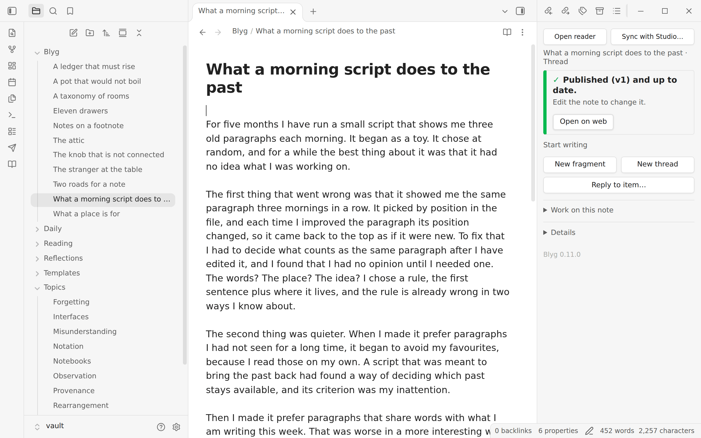

## What it does

- **Publish** a note from a chosen vault folder as a fragment (up to 1,000 characters by default) or a thread. Ids,
  versions and change notes are handled for you; the Studio keeps them.
- **Look before you send.** A window shows what the Studio will render and what changes. Nothing is published without
  your tap; a failed send is kept as a draft and your note is left untouched.
- **Images.** A note in a Studio route can embed images from your vault (`![[photo.png]]`, `![[photo.png|a red door]]` or
  ``). They are uploaded to your Studio when you publish, kept with the item, and shown in the post.
  PNG, JPEG, GIF, WebP and SVG, up to 5 MB each. The image has to be inside the same vault folder as the note's route (or a
  folder below it): one from elsewhere in the vault is refused, and never read. Anything else that cannot be sent is also refused
  before anything is sent, with the reason. Nothing is copied or renamed in your vault.
- **Drafts only folders.** Mark a folder as "Drafts only" to rehearse: notes there are sent as private drafts and never
  published.
- **Quote and respond.** Insert a quote (a whole item or a passage) from your own items or from a blyg your Studio
  follows, find an item by pasting its address, or reply to an item with a *stub* (a thread that says it responds to one
  item; the panel then reads “Stub: a reply to …”).
- **Quote from the web.** “Insert web quote (plain Markdown)” turns a passage and an address into an ordinary Markdown quote
  with an italic source link: paste both into a small form (an alias for the link is optional; without one the address is
  shortened), and the form keeps your text if the app is closed while you copy the address. It is not a blyg item: nothing is
  checked, fetched or sent. Settings → Web quote holds a template for the whole block, so you decide where the quote, the
  link and any blank line go.
- **See what you answer.** A reply note starts with the line that quotes the item it answers; in Live Preview and Reading view that line shows the item's text (a view only: the text is fetched when the note is shown and never written into your vault).
- **Read (experimental).** “Open reader” shows the posts of the blygs your Studio follows as a feed (newest first, or by reading time;
  filter by blyg, length or unread; the choices are remembered) and the mentions of your items. A post opens as text on its own calm
  reading surface (quotes shown as quotes; contrast and font are settings); one tap or a pull-up at the end
  marks it read and goes to the next. Posts are shown in the reader only and are never written into your notes; to open fast, the reader keeps the newest 200 posts (without their Markdown) in one file in the plugin's own folder, for the Studio they came from, for two weeks ("Clear the reader's saved list" in the command palette removes it).
- **Keep both sides in step.** Pull the Studio's copy into the note, import items that were written in the Studio,
  withdraw an item, delete a draft, put items into your Studio's hoppers.
- **Mobile first.** Everything runs on iOS and Android as well as desktop; no desktop-only APIs are used.

## What your post looks like

What you send from Obsidian is published by your Studio as a page of your blyg. Items have no titles of their own: the large
heading is the name of your blyg, the same above every item. On the left a fragment, on the right a thread that quotes a
neighbour's item (the quote carries the author's name and the version it was taken from; only the top of the thread is shown):

| A fragment | A thread that quotes a neighbour |
|:---:|:---:|
| 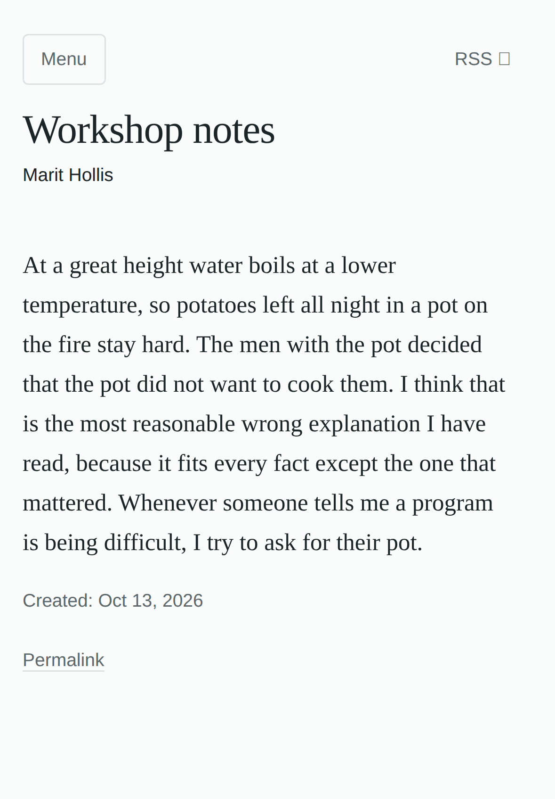 | 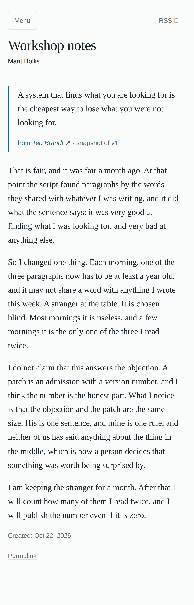 |

## A look inside Obsidian

**Read the blygs you follow** in the reader (experimental): the newest posts as cards, with what is unread, what answers you and how long each takes to read:

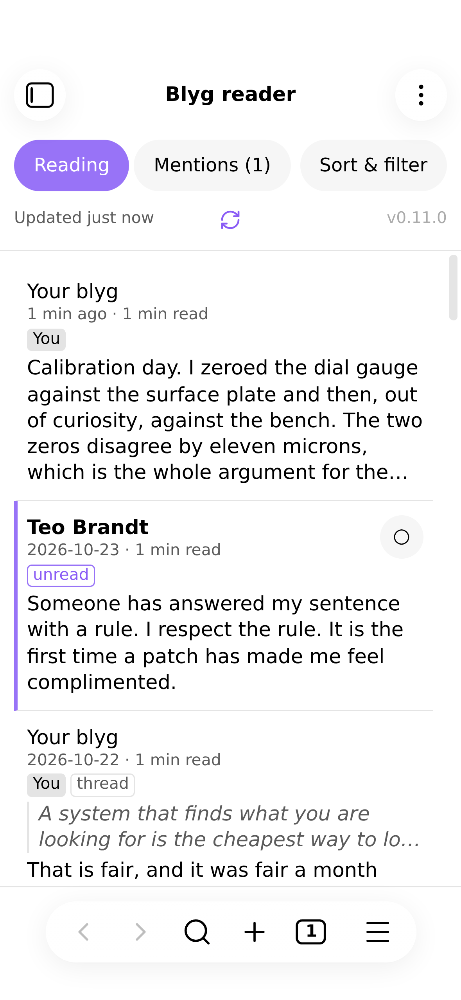

Open a post to read it as text. Reply starts a new thread that quotes it (or just the passage you selected), and Next takes you on:

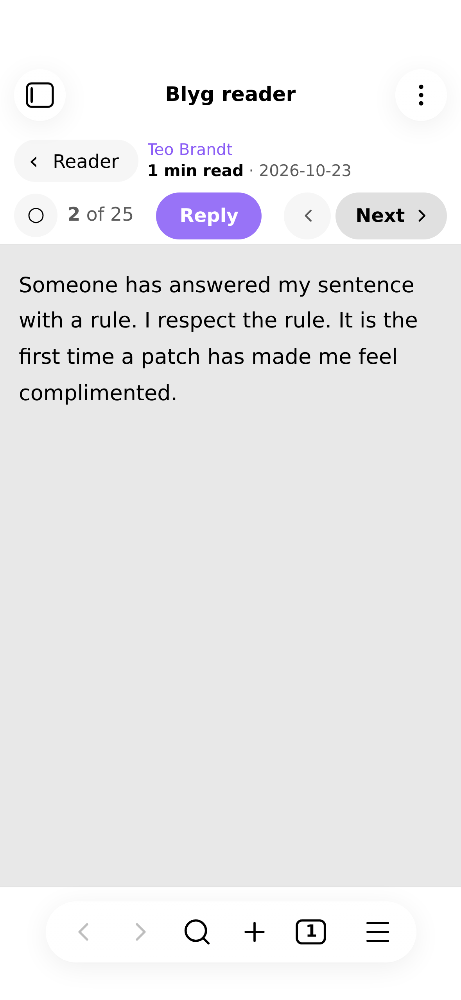

**Before anything is sent**, a window shows what readers will see and what changes:

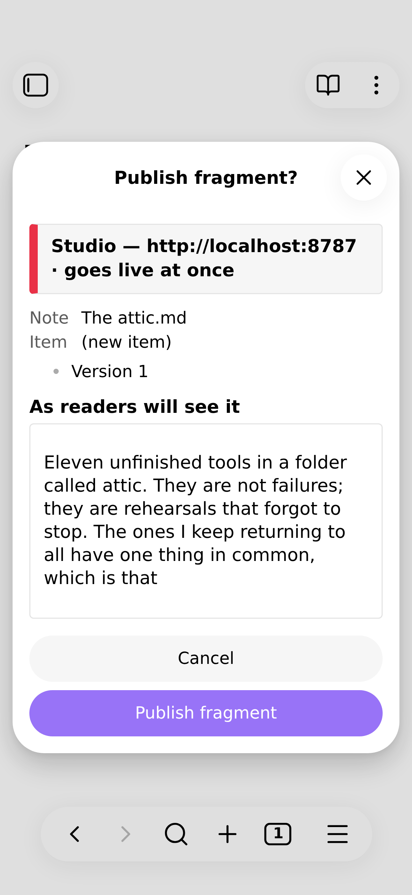

**Quote another blyg** by searching its items (or pasting an address):

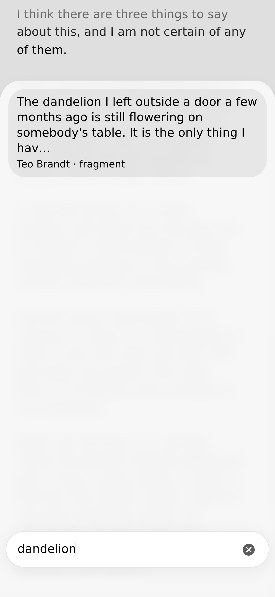

**Paste an address, or an item's id, to find exactly one item.** The reader's "Copy id" gives `[[id | "…"]]`; paste all of it or the id alone. While the Studio looks it up, a "Looking up…" line with a spinner shows and the list below is greyed and cannot be chosen from; then the one item is there. An id finds your own items and items of blygs your Studio is subscribed to; for any other blyg, paste the item's address.

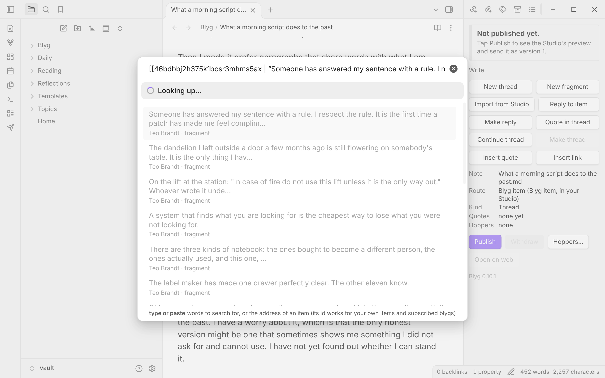

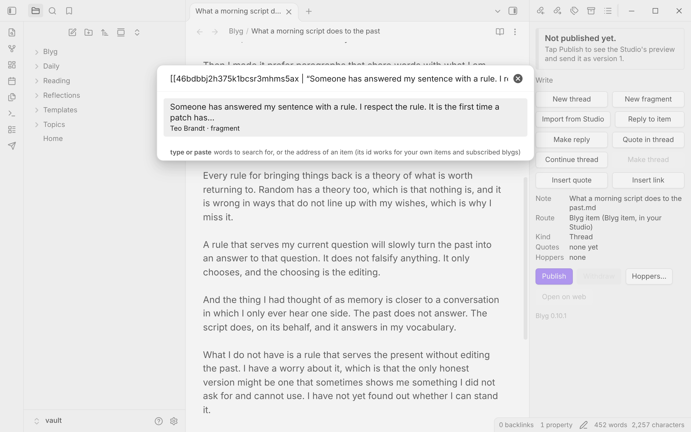

| 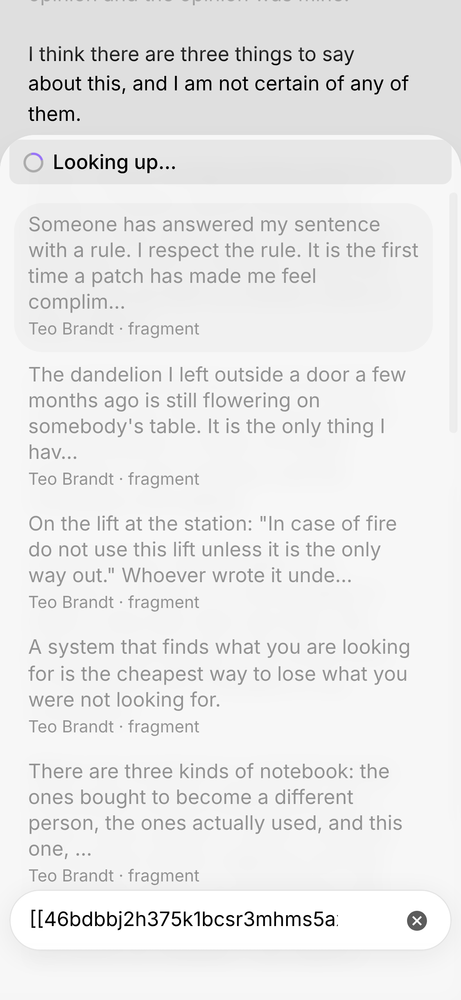 | 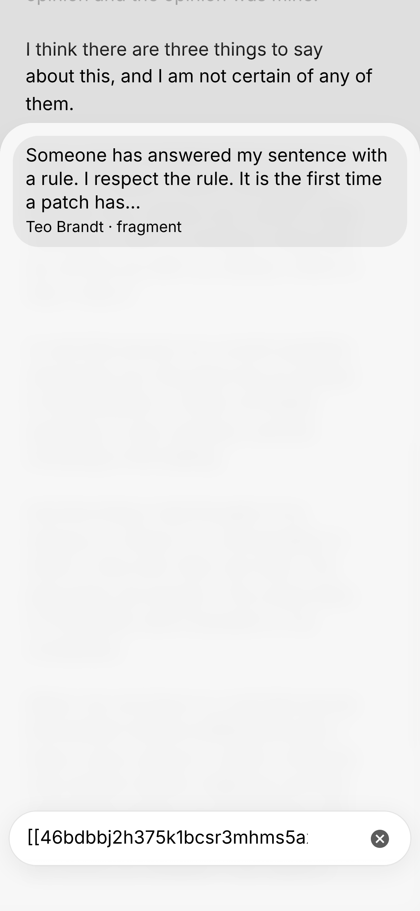 |
|---|---|

**A thread that quotes a neighbour's fragment.** The panel shows the quote under *From other blygs*:

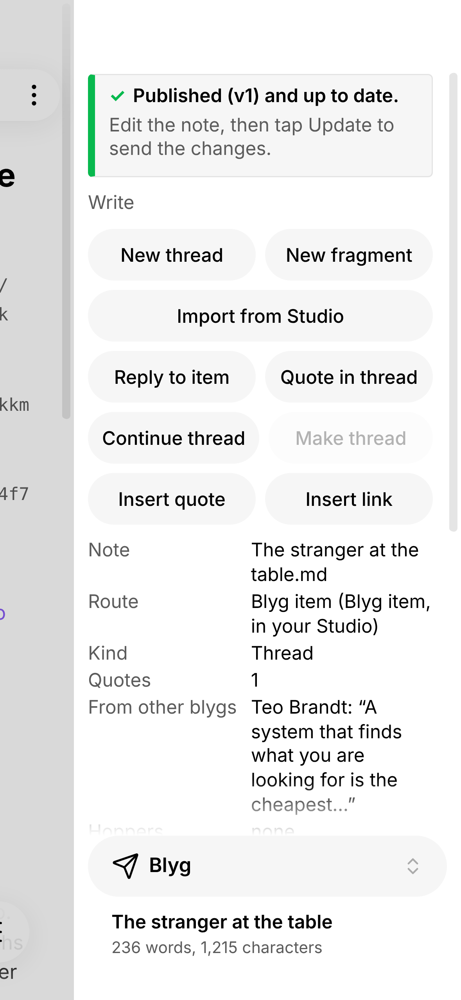

**Settings** for a Studio-only setup need just the Studio address and a token:

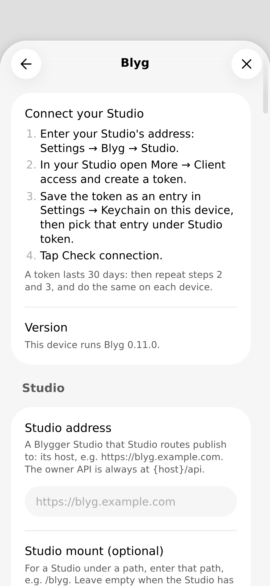

## The idea: your vault stays the source

Obsidian's *file over app* idea is that what you write should outlive any one app: plain files you own, readable with
anything. This plugin tries to keep that true while you publish:

- **Your vault files are the master copies.** You write in the note and publish from it. There is no second editor, no
  export step and no separate repository to keep in step by hand. What the plugin needs to remember about a note (its kind,
  the version last sent, a hash of what was sent) is written into the note's own properties (the `blyg_…` keys).
- **Open formats on both sides.** Notes are plain Markdown with ordinary properties. Your Studio is open source and speaks
  the open Blygger protocol through a REST API with tokens of its own. So nothing in your files ties them to this plugin, and
  in principle another client, such as another mobile app, can work with the same Studio and the same writing. (This plugin is
  one such client; it is not claimed to be the only possible one.)
- **Your own Studio, your own backups.** The published side runs on a Studio you own, and because the drafts are ordinary
  vault files, whatever sync, backup or version history you already use for your vault covers them too.

What this does not mean: the Studio, not your vault, is the authority for published items. Ids are permanent, versions only
go up, and withdrawing an item leaves an end note and never deletes its address. The plugin's settings and its cache of the
blygs you follow live in the plugin's own storage, not in your notes.

## What you need

1. **Obsidian 1.13.0 or newer** (the plugin stores secrets in Obsidian's keychain and uses the 1.13 settings screen).
2. **A Blygger Studio** that you own and have signed in to. Blygger Studio is the reference server of the Blygger
   protocol (open source: [blygger/blygger-studio](https://github.com/blygger/blygger-studio)). The plugin needs
   **Studio 0.51.0 or newer** (API contract 5). Every change to the plugin is tested against Studio 0.51.0 (the oldest it
   supports) and against the newest Studio release, last seen on 18 November 2026 with Studio 0.62.0; a newer
   minor version is accepted with a quiet note, an older Studio is refused before anything is sent.
3. **An access token from that Studio** (see *Token*).

You do **not** need a GitHub account or a static site. (An older mode that commits to a GitHub-hosted site still exists
in the code for early users and is hidden when you only use a Studio.)

## Install

1. Obsidian → **Settings → Community plugins** → turn on community plugins if asked → **Browse** → search **Blyg** →
   **Install** → **Enable**. Its plugin id is `blyg`.
2. Keep it updated from the same screen. Your settings live in the plugin's own data file and survive updates.

**If it does not show up in the list yet** (a new release can take up to a day to appear), or if you want a test build, use the
install helper **BRAT**: install “Obsidian42 - BRAT” from the community list, open the command palette → **BRAT: Plugins: Add a
beta plugin for testing**, and add the repository **`florianlohse/blyg-obsidian`**, version *Latest*. Do not enable the BRAT
copy and the community copy together.

## Set up

1. **Token.** In your Studio open **More → Client access → REST API** and create a token and tick **every permission**.
   Publishing needs `owner:read`, `owner:draft` and `owner:publish`; `owner:manage` is for changing hoppers, dismissing mentions and asking your Studio to
   look for new posts, and `reading:state` for read marks in the reader. Copy it (it is shown once).
2. **Keychain.** In Obsidian open **Settings → Keychain** and add a secret (lowercase letters, digits and dashes in the
   name, for example `blyg-studio`); paste the token as its value. Keychain entries stay on one device: repeat on each
   phone and tablet.
3. **Settings → Blyg → Studio.** Enter the **Studio address** (for example `https://blyg.example.com`; fill **Studio mount**
   only if your Studio lives below a path such as `/blyg`) and choose the keychain entry in **Studio token**. The *Setup
   check* row at the top of the settings lists what is still missing; it asks only for these two.
4. **Routes.** A route maps a vault folder to your Studio. A new install already has one: notes in the folder `blyg/` are
   sent to the Studio (change the folder under **Routes → Vault folder**, or **Add route** for more). Tick **Drafts
   only** on a route for a first try: its notes become private drafts and are never published.
5. Tap **Check connection** (in the Studio group). It names your Studio's version and API contract (for example
   “Studio 0.51.0, contract 5.2.0”), the permissions of the token and how long it still lasts.
6. Open a note in the route folder, open the panel (the ribbon icon “Open Blyg panel”, or the command **Blyg: Open panel**)
   and tap **Publish…** (**Send draft…** on a Drafts-only route); the window that opens shows what will be sent, and its **Publish** (**Send draft**) button sends it.

GitHub settings and the folder “Kind” stay hidden unless you switch on **Website (GitHub) → Publish to a GitHub-hosted site**.
That box holds what essays, pages and other plain files need: the repository, the production branch and the GitHub token.
The box **Advanced**, shown below it, holds only the older way of running a blyg from a GitHub repository (the preview channel,
“Blyg address”, the items folder). Switching the switch off hides both without deleting anything. The commands that move an
old GitHub-site item into the Studio (**Studio: repost this note**, **Studio: list reposted items**) are offered only then.

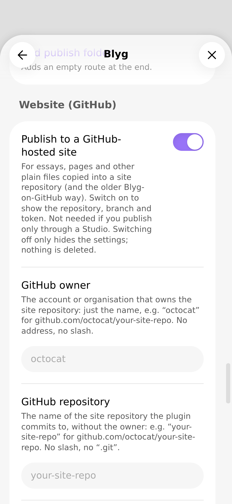

## What is sent where

The plugin makes requests only through Obsidian's `requestUrl`, to these hosts:

| Host | What goes there | Credential |
|---|---|---|
| **Your Studio** (the address you set) | Your note's text and metadata when you send it, the image files the note embeds (only when you publish), and reads of your items, hoppers and followed blygs' items for the panel and pickers. | The Studio token, in a header. Never in a URL. |
| **The Studio's public pages** (same host) | The public manifest, read to find your blyg's address. | None. |
| **The reader's requests to your Studio** (same host) | The list of posts you read and your mentions, a look at the Studio's change counters every 30 seconds while the reader is open (and every three seconds during a Refresh), the read marks you set, a request that your Studio look for new posts (only when you press Refresh), and the look-up of an item when you tap a quote's source. | The Studio token, in a header. |
| **A blyg's own server** (only for what you open in the reader) | A post's image, when you tap it (or always, if you chose “Always load”), and the page itself if you tap “Browser” (that opens your browser, not the plugin). Image requests carry no token and no cookies, so that blyg's server can see that someone read the post. | None. |
| `api.github.com` | Only if you use the older GitHub mode. Not used in Studio-only setups. | A GitHub token, only to this host. |

Nothing else: no analytics, no telemetry, no third-party servers. Text from other blygs is shown only after being
sanitised and is kept in the plugin's own storage, never written into your vault.

Only notes in your route folders, and the images they embed from the same folders, are ever sent, and only when you tap. Obsidian comments (`%%…%%`) and block ids are
stripped from the published text.

## Token

- The plugin needs the Studio permissions **`owner:read`**, **`owner:draft`**, **`owner:publish`**; **`owner:manage`**
  is optional (hoppers, dismissing a mention in the reader, and asking your Studio to look for new posts in the reader). **`reading:state`** is optional too: without
  it the reader works, but marking a post read or unread is refused (and says so). For the reader, make the token with every permission.
- The token is stored only in **Obsidian's keychain**. The settings hold the *name* of the entry, never the value; the
  plugin never logs it, writes it to a file or sends it anywhere except your Studio's host.
- **A Studio token expires after 30 days** and cannot be refreshed. The plugin warns five days before the end;
  then create a new token and update the keychain entry. A leaked token is limited to its permissions and ends by
  itself; you can revoke it in the Studio (More → Client access).
- Signing in without a monthly token (OAuth) is planned, see below.

## Known gaps

- **Images only in Studio routes.** A note in an older GitHub-hosted route that embeds an image is refused with an explanation.
  In a Studio route images are published as they are: no resizing (`|300` after a name is ignored), no HEIC conversion (convert
  a camera photo first), and no way yet to bring a Studio item's images back into a note (a pulled or imported item keeps the
  Studio's image addresses, which show as web images).
- **The reader is experimental.** It shows what your Studio has fetched (your Studio looks at the blygs you follow every half hour;
  the reader asks it to look when you press Refresh). Not there yet: search, and posts older than the newest 200 (the reader loads the newest 200 of everything
  you follow; with many blygs the older unread ones are out of reach until "load older" exists, which is planned). Replies to a post are shown only where you can see them (your own, and posts of blygs you follow), never
  asked of other blygs.
- **Tokens by hand, every 30 days.**
- **One Studio.** Setups with several Studios are not supported.
- **Mobile-tested lightly.** Tested on iPad and iPhone by the author; Android is untested.

## Planned (not promised)

Resizing images; OAuth sign-in instead of the monthly token; automatic checks for new Studio items; a public
address setting for Studios behind a proxy.

## Privacy and safety in short

Publishing needs an explicit tap and shows a preview. If something cannot be checked as safe (broken YAML, over a size
cap, ambiguous ids, a link to a private note), the send is refused before any network call. Published ids are permanent:
withdrawing an item leaves an end note and never deletes the address.

## Help, issues

Open an issue on this repository. Please leave tokens out of anything you paste; the plugin's messages never contain one.

Pull requests are not accepted for now: this repository is a published copy of the plugin's source, and code changes are made elsewhere. If you have a fix or an idea, describe it in an issue.

## License

MIT — see `LICENSE`. Credits: protocol by Venkatesh Rao and contributors (`blygger/blygger-spec`, MIT); ideas and
patterns from `brndnpink/blyg-publisher` (MIT), `blygger/blygger-studio` (MIT), `aneeshsathe/blygger-desktop` ("Burrow")
and QuickAdd's keychain handling (`chhoumann/quickadd`, MIT).

**Thanks to Burrow.** Burrow, the macOS studio and reader by Aneesh Sathe (`aneeshsathe/blygger-desktop`), paved the way for this plugin's reader and
for how it keeps up with your Studio. Its release 0.21 ("Sync reads less from the blyg") showed how to read little: look at the Studio's change counters
first and read the reading list only when something moved, never in a tight loop; a safety-net full read that backs off while it finds nothing; stepping
back when the Studio answers with an error; pages of the largest size; and asking the blygs to be checked only on request. Its bracket-grammar test vectors
(MIT) are replayed in this plugin's tests, and its notes on how a reader should read (a stream, an unread dot rather than a count) were a reference for the reader's design.
