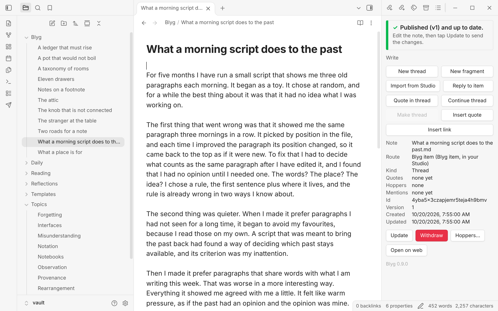
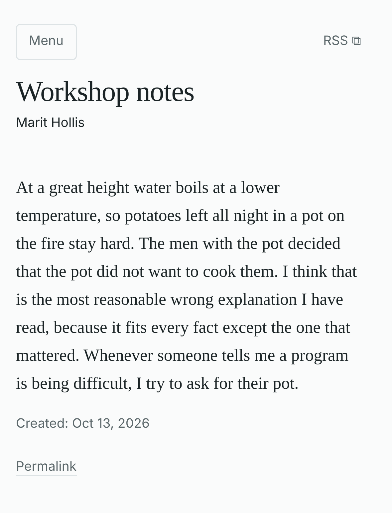
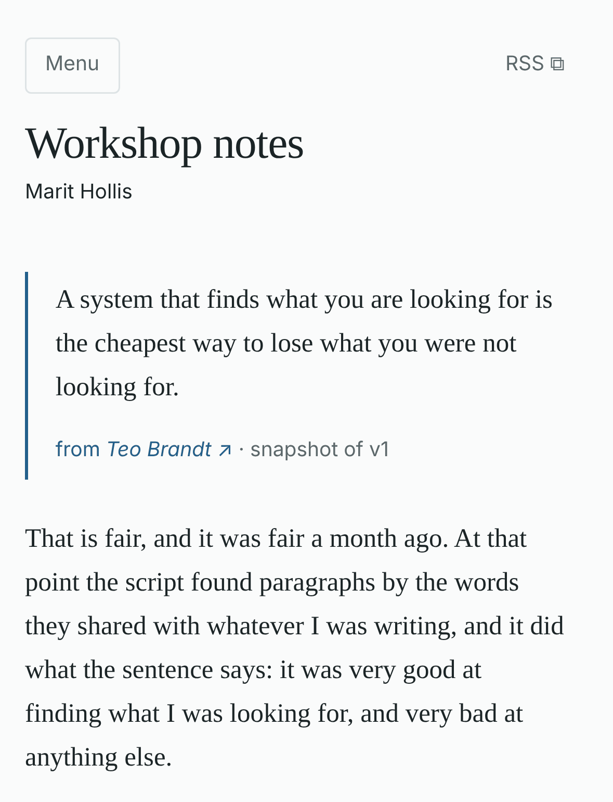
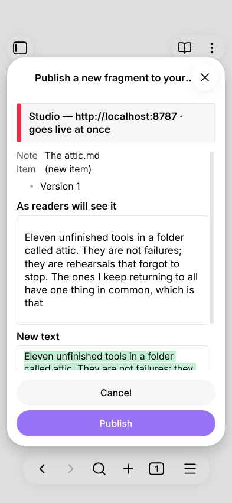
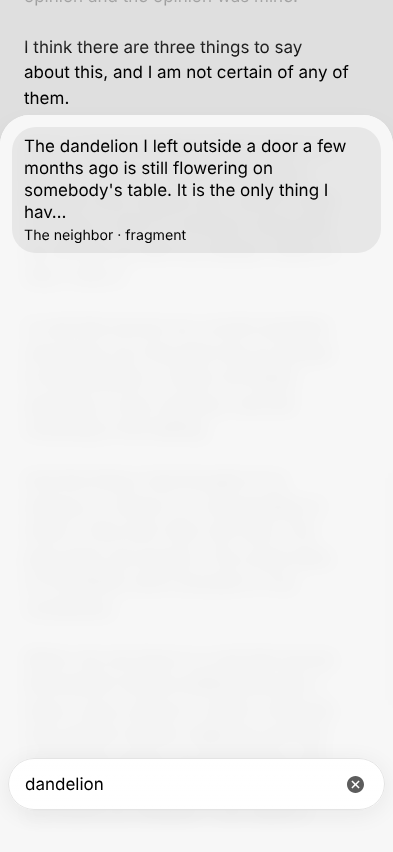
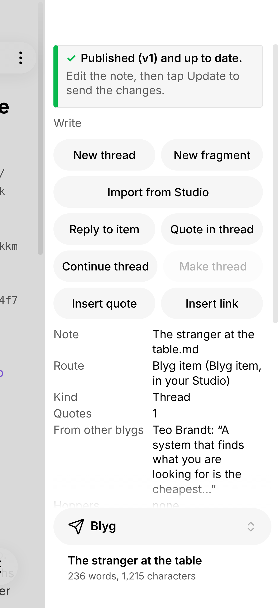
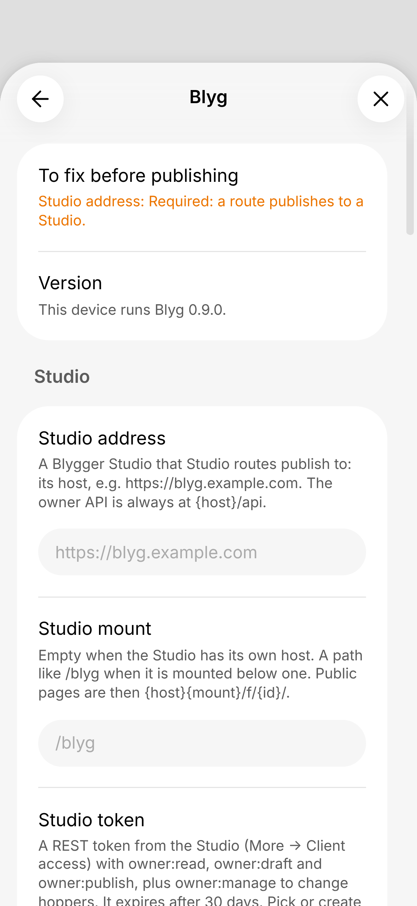
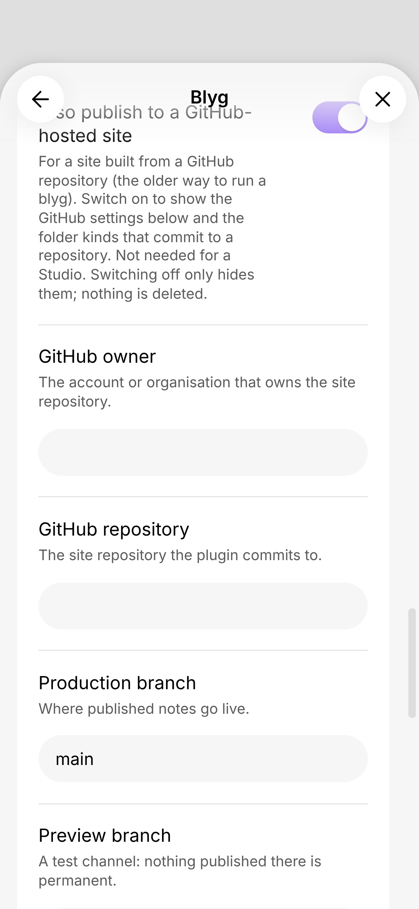

# Blyg for Obsidian

Write in your vault, publish to your **[Blygger](https://blygger.org)** blyg from **iPhone/iPad or desktop**. Short
*fragments* and long *threads* that quote other people's items go to your own **Blygger Studio**; the plugin checks what
will change before anything leaves your vault.

> **Beta (0.9.x).** Installed through BRAT, not yet in Obsidian's community-plugin list. Expect rough edges and read
> *Known gaps* below before relying on it.

## What it does

- **Publish** a note from a chosen vault folder as a fragment (up to 1,000 characters by default) or a thread. Ids,
  versions and change notes are handled for you; the Studio keeps them.
- **Look before you send.** A window shows what the Studio will render and what changes. Nothing is published without
  your tap; a failed send is kept as a draft and your note is left untouched.
- **Drafts only folders.** Mark a folder as "Drafts only" to rehearse: notes there are sent as private drafts and never
  published.
- **Quote and respond.** Insert a quote (a whole item or a passage) from your own items or from a blyg your Studio
  follows, find an item by pasting its address, or reply to an item with a *stub* (a thread that says it responds to one
  item; the panel then reads “Stub: a reply to …”).
- **Keep both sides in step.** Pull the Studio's copy into the note, import items that were written in the Studio,
  withdraw an item, delete a draft, put items into your Studio's hoppers.
- **Mobile first.** Everything runs on iOS and Android as well as desktop; no desktop-only APIs are used.

## What your post looks like

What you send from Obsidian is published by your Studio as a page of your blyg. Items have no titles of their own: the large
heading is the name of your blyg, the same above every item. On the left a fragment, on the right a thread that quotes a
neighbour's item (the quote carries the author's name and the version it was taken from; only the top of the thread is shown):

| A fragment | A thread that quotes a neighbour |
|:---:|:---:|
|  |  |

## A look inside Obsidian

**Before anything is sent**, a window shows what readers will see and what changes:

**Quote another blyg** by searching its items (or pasting an address):

**A thread that quotes a neighbour's fragment.** The panel shows the quote under *From other blygs*:

**Settings** for a Studio-only setup need just the Studio address and a token:

## The idea: your vault stays the source

Obsidian's *file over app* idea is that what you write should outlive any one app: plain files you own, readable with
anything. This plugin tries to keep that true while you publish:

- **Your vault files are the master copies.** You write in the note and publish from it. There is no second editor, no
  export step and no separate repository to keep in step by hand. What the plugin needs to remember about a note (its kind,
  the version last sent, a hash of what was sent) is written into the note's own properties (the `blyg_…` keys).
- **Open formats on both sides.** Notes are plain Markdown with ordinary properties. Your Studio is open source and speaks
  the open Blygger protocol through a REST API with tokens of its own. So nothing in your files ties them to this plugin, and
  in principle another client, such as another mobile app, can work with the same Studio and the same writing. (This plugin is
  one such client; it is not claimed to be the only possible one.)
- **Your own Studio, your own backups.** The published side runs on a Studio you own, and because the drafts are ordinary
  vault files, whatever sync, backup or version history you already use for your vault covers them too.

What this does not mean: the Studio, not your vault, is the authority for published items. Ids are permanent, versions only
go up, and withdrawing an item leaves an end note and never deletes its address. The plugin's settings and its cache of the
blygs you follow live in the plugin's own storage, not in your notes.

## What you need

1. **Obsidian 1.13.0 or newer** (the plugin stores secrets in Obsidian's keychain and uses the 1.13 settings screen).
2. **A Blygger Studio** that you own and have signed in to. Blygger Studio is the reference server of the Blygger
   protocol (open source: [blygger/blygger-studio](https://github.com/blygger/blygger-studio)). The plugin needs
   **Studio 0.51.0 or newer** (API contract 5). It is tested with Studio 0.51.0 to 0.53.0 (API contract 5.2 to 5.4); a newer
   minor version is accepted with a quiet note, an older Studio is refused before anything is sent.
3. **An access token from that Studio** (see *Token*).

You do **not** need a GitHub account or a static site. (An older mode that commits to a GitHub-hosted site still exists
in the code for early users and is hidden when you only use a Studio.)

## Install (BRAT, about 3 minutes)

The plugin is not in the community list yet; the install helper **BRAT** installs it from this repository.

1. Obsidian → **Settings → Community plugins** → turn on community plugins if asked → **Browse** → search
   **BRAT** (“Obsidian42 - BRAT”) → **Install** → **Enable**.
2. Open BRAT's settings (or the command palette: **BRAT: Plugins: Add a beta plugin for testing**) and add the repository
   **`florianlohse/blyg-obsidian`**, version *Latest*.
3. **Settings → Community plugins** → make sure **Blyg** is switched on. Its plugin id is `blyg`.

BRAT keeps the plugin updated. Your settings live in the plugin's own data file and survive updates.

## Set up

1. **Token.** In your Studio open **More → Client access → REST API** and create a token with the permissions
   `owner:read`, `owner:draft` and `owner:publish`. Add `owner:manage` if you want to change hoppers from Obsidian.
   Copy it (it is shown once).
2. **Keychain.** In Obsidian open **Settings → Keychain** and add a secret (lowercase letters, digits and dashes in the
   name, for example `blyg-studio`); paste the token as its value. Keychain entries stay on one device: repeat on each
   phone and tablet.
3. **Settings → Blyg → Studio.** Enter the **Studio address** (for example `https://blyg.example.com`; fill **Studio mount**
   only if your Studio lives below a path such as `/blyg`) and choose the keychain entry in **Studio token**. The *Setup
   check* row at the top of the settings lists what is still missing; it asks only for these two.
4. **Routes.** A route maps a vault folder to your Studio. A new install already has one: notes in the folder `blyg/` are
   sent to the Studio (change the folder under **Routes → Vault folder**, or **Add route** for more). Tick **Drafts
   only** on a route for a first try: its notes become private drafts and are never published.
5. Tap **Check connection** (in the Studio group). It names your Studio's version and API contract (for example
   “Studio 0.51.0, contract 5.2.0”), the permissions of the token and how long it still lasts.
6. Open a note in the route folder, open the panel (the ribbon icon “Open panel”, or the command **Blyg: Open panel**)
   and tap **Publish** (**Send draft** on a Drafts-only route).

GitHub settings, “Blyg address”, the folder “Kind” and the preview channel belong to an older way of running a blyg from a
GitHub repository. They stay hidden unless you switch on **Advanced → Also publish to a GitHub-hosted site** at the bottom
of the settings; the GitHub fields then appear right under the switch, and switching it off hides them again without deleting
anything. The commands that move an old GitHub-site item into the Studio (**Studio: repost this note**, **Studio: list
reposted items**) are offered only then.

## What is sent where

The plugin makes requests only through Obsidian's `requestUrl`, to these hosts:

| Host | What goes there | Credential |
|---|---|---|
| **Your Studio** (the address you set) | Your note's text and metadata when you send it, and reads of your items, hoppers and followed blygs' items for the panel and pickers. | The Studio token, in a header. Never in a URL. |
| **The Studio's public pages** (same host) | The public manifest, read to find your blyg's address. | None. |
| `api.github.com` | Only if you use the older GitHub mode. Not used in Studio-only setups. | A GitHub token, only to this host. |

Nothing else: no analytics, no telemetry, no third-party servers. Text from other blygs is shown only after being
sanitised and is kept in the plugin's own storage, never written into your vault.

Only notes in your route folders are ever sent, and only when you tap. Obsidian comments (`%%…%%`) and block ids are
stripped from the published text.

## Token

- The plugin needs the Studio permissions **`owner:read`**, **`owner:draft`**, **`owner:publish`**; **`owner:manage`**
  is optional (hoppers).
- The token is stored only in **Obsidian's keychain**. The settings hold the *name* of the entry, never the value; the
  plugin never logs it, writes it to a file or sends it anywhere except your Studio's host.
- **A Studio token expires after 30 days** and cannot be refreshed. The plugin warns five days before the end;
  then create a new token and update the keychain entry. A leaked token is limited to its permissions and ends by
  itself; you can revoke it in the Studio (More → Client access).
- Signing in without a monthly token (OAuth) is planned, see below.

## Known gaps

- **No images.** Embedded images are not uploaded; a note with `![[image.png]]` is refused with an explanation.
- **No mentions list.** Who quoted or answered you is visible in the Studio, not yet in Obsidian.
- **No reader stream.** Read the blygs you follow in the Studio; the plugin lets you quote and reply to their items but
  does not show a feed.
- **Tokens by hand, every 30 days.**
- **One Studio.** Setups with several Studios are not supported.
- **Beta, mobile-tested lightly.** Tested on iPad and iPhone by the author; Android is untested.

## Planned (not promised)

Mentions list; images; OAuth sign-in instead of the monthly token; automatic checks for new Studio items; a public
address setting for Studios behind a proxy; listing in Obsidian's community plugins after a beta period (1.0).

## Privacy and safety in short

Publishing needs an explicit tap and shows a preview. If something cannot be checked as safe (broken YAML, over a size
cap, ambiguous ids, a link to a private note), the send is refused before any network call. Published ids are permanent:
withdrawing an item leaves an end note and never deletes the address.

## Help, issues

Open an issue on this repository. Please leave tokens out of anything you paste; the plugin's messages never contain one.

Pull requests are not accepted for now: this repository is a published copy of the plugin's source, and code changes are made elsewhere. If you have a fix or an idea, describe it in an issue.

## License

MIT — see `LICENSE`. Credits: protocol by Venkatesh Rao and contributors (`blygger/blygger-spec`, MIT); ideas and
patterns from `brndnpink/blyg-publisher` (MIT), `blygger/blygger-studio` (MIT), `aneeshsathe/blygger-desktop` ("Burrow")
and QuickAdd's keychain handling (`chhoumann/quickadd`, MIT).
